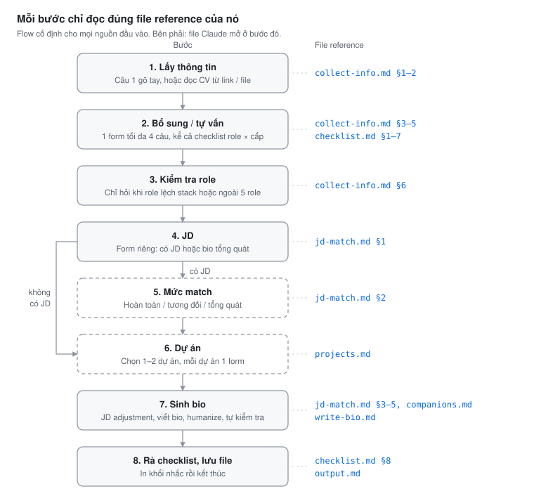

<h1 align="center">generate-short-bio</h1>

<p align="center">
  <strong>Short bio</strong><br>
  <sub>Short Bio · Core Skills · Projects, xuất bằng 🇻🇳 Tiếng Việt · 🇬🇧 English · 🇯🇵 日本語</sub><br>
  <code>/generate-short-bio</code>
</p>

<p align="center">
  <a href="./LICENSE"></a>
  <a href="#cài-đặt"></a>
  <a href="https://agentskills.io/specification"></a>
  <a href="#cách-hoạt-động"></a>
</p>

Khi đọc hồ sơ một ứng viên, khách hàng muốn thấy ngay những thông tin đáp ứng yêu cầu của mình. Phần giới thiệu cho biết người này làm được việc gì và ở mức nào, danh sách skill cho biết các công nghệ chính đã dùng bao lâu, còn phần dự án cho biết việc nào do chính ứng viên đảm nhiệm. Một short bio tốt giúp khách hàng tập trung ngay vào những điều đó.

**`generate-short-bio` viết hồ sơ theo cách đó.** Skill đọc CV của bạn, bám theo JD của khách hàng nếu có, đưa điều khách hàng quan tâm lên trước ở từng phần và không thêm chi tiết nào không có nguồn. Bạn chỉ việc chọn vài đáp án có sẵn, rồi nhận về một file Markdown cùng danh sách những điểm nên xem lại trước khi gửi.

Dưới đây là một lần chạy thật với CV Backend 4 năm và JD Senior Backend, dùng dữ liệu giả lập.

**1. Đầu vào.** CV ghi Laravel 4 năm, có chứng chỉ JLPT N3, chưa có AWS. Dự án cũ không ghi vai trò, phần trách nhiệm chỉ có một câu chung chung. JD yêu cầu từ 5 năm kinh nghiệm và 3 năm AWS.

<p align="center">
  
</p>

**2. Quy trình.** Skill tóm tắt CV và chỉ ra chỗ chưa khớp: CV ghi 4 năm, nhưng các dự án kéo dài khoảng 5 năm. Mọi chỗ còn thiếu về hồ sơ được gom vào một form có đáp án gợi ý (các việc theo Level, số năm kinh nghiệm). Member chỉ cần chọn, rồi chọn tiếp mức bám sát JD. Sau đó skill hỏi riêng về dự án cũ còn mỏng: việc đã làm, vị trí và stack, với lựa chọn lấy từ CV.

<p align="center">
  
</p>

**3. Đầu ra.** File bio dùng đúng câu trả lời của member. Việc member xác nhận ở form được viết vào Short Bio, việc đã làm ở dự án cũ lấy từ lựa chọn trong form dự án, JLPT N3 nằm ở header. Laravel lên 5 năm theo số năm member chọn, AWS được thêm theo JD, còn Tech Stack của từng dự án giữ nguyên. Khối nhắc cuối file liệt kê mọi điều chỉnh để member kiểm tra trước khi gửi.

<p align="center">
  
</p>

Chữ tím in nghiêng trong ảnh là chú thích thêm, không phải output. Trong Claude Code, các câu hỏi hiện dạng form để bấm chọn; ảnh ghi lại cùng nội dung ở dạng danh sách. Xem thêm [một ví dụ khác](./docs/example.md).

## Tính năng

- Bạn có thể đưa link CV (Google Docs, Sheets, Drive, PDF), đưa file CV, hoặc gõ thông tin ngay sau lệnh.
- Chỗ nào còn thiếu, skill gom lại hỏi một lần trong một form. Mỗi câu có sẵn đáp án gợi ý dựa trên dữ liệu của bạn, thường chỉ cần bấm chọn.
- Bio của Junior, Middle và Senior được viết khác nhau. Nếu Level của bạn cần thể hiện một việc mà CV chưa nhắc tới, skill sẽ hỏi chứ không tự viết vào.
- Khi có JD, bạn chọn mức bám sát. Số năm kinh nghiệm chỉ được nâng lên theo JD, không bao giờ bị hạ xuống, và skill xử lý được cả trường hợp bạn ứng tuyển sang Role khác.
- Ý nào trong bio cũng lấy từ CV, thông tin bạn nhập hoặc JD. Thiếu thông tin thì skill để trống và nhắc bạn điền.
- Chứng chỉ ngoại ngữ (JLPT, TOEIC, IELTS...) và chứng chỉ chuyên môn (AWS Certified, PMP...) có trong CV được đưa vào hồ sơ đúng như bạn ghi. Học vấn, lương và thông tin cá nhân khác thì bỏ qua.
- Bio viết theo kiểu giới thiệu hồ sơ: không xưng "tôi", không nêu tên dự án, nói skill dùng để làm gì thay vì chỉ liệt kê, và được chạy qua [humanizer](https://github.com/blader/humanizer) để bớt giọng máy.

## Cài đặt

1. Cài [Claude Code](https://code.claude.com) và đăng nhập.
2. Chạy lệnh cài skill:

```bash
curl -fsSL https://raw.githubusercontent.com/TOMOSIA-VIETNAM/agent-skillset/main/install.sh | bash
```

Skill được cài vào `~/.claude/skills/generate-short-bio/`. Nếu máy chưa có skill `humanizer`, lệnh này sẽ giúp cài luôn (bản cố định theo một commit để không bị ảnh hưởng khi upstream thay đổi). Cài xong thì khởi động lại Claude Code. Muốn cập nhật thì chạy lại lệnh trên, còn muốn gỡ thì thêm `-s -- --uninstall` ngay sau `bash`.

## Cách dùng

| Lệnh | Khi nào dùng |
| --- | --- |
| `/generate-short-bio` | Bạn chưa chuẩn bị gì. Skill sẽ in ra danh sách thông tin cần nhập |
| `/generate-short-bio <link hoặc file CV>` | Bạn đã có CV. Skill đọc, tóm tắt lại rồi chỉ hỏi phần còn thiếu |
| `/generate-short-bio <họ tên, Role, số năm, stack, email…>` | Nhập nhanh, ví dụ `Nguyễn Văn A, Frontend, 3 năm, React, a.nguyen@example.com` |
| Thêm `JD: <link / file / nội dung>` vào lệnh | Bạn có JD của khách hàng. Ghi thêm `mức tương đối khớp` nếu muốn skill khỏi hỏi mức match |
| Nhắn *"tạo bản en"* hoặc *"tạo bản ja"* sau khi xong | Bạn cần thêm bản tiếng Anh hoặc tiếng Nhật |

Skill cần ít nhất họ tên, Role, số năm kinh nghiệm, tech stack và email. Nên ghi kèm số năm của các skill chính (framework, ngôn ngữ, database, cloud), ví dụ `Laravel (5 năm), PHP (5 năm), MySQL (4 năm)`; skill phụ như thư viện, công cụ thì chỉ cần tên. Ngày sinh, domain và dự án thì không bắt buộc, nhưng có 1 hoặc 2 dự án thì bio mới đủ 3 thành phần. File được lưu ở thư mục bạn đang đứng, tên dạng `short-bio-[ten]-[YYYY-MM-DD].md`. Nếu đã có file trùng tên, skill hỏi bạn muốn tạo bản `-v2` hay ghi đè.

> [!TIP]
> Link CV phải bật chia sẻ *Anyone with the link*. LinkedIn yêu cầu đăng nhập nên skill không đọc được; bạn hãy xuất hồ sơ ra PDF rồi đưa file đó.

## Cách hoạt động

<p align="center">
  
</p>

Mỗi lần thực thi skill đều sẽ đi qua 8 bước này theo đúng thứ tự. Nếu không có JD, skill bỏ qua bước 5; nếu không có dự án, skill bỏ qua bước 6. Ở bước 6, skill chọn 1–2 dự án tiêu biểu (khớp JD nếu có) và hỏi bạn từng dự án bằng form có gợi ý lấy từ CV: bạn làm những việc gì, mô tả còn thiếu ý nào, dự án có dùng thêm công nghệ nào. Trước khi viết bio ở bước 7, skill in một dòng tóm tắt `Xác nhận: [Tên] · Role · Mức độ · JD · Match · File` để bạn biết nó sắp làm gì, rồi làm tiếp luôn mà không chờ bạn trả lời.

Khi có JD, mức bám sát quyết định số năm ghi trong bio (T là số năm thực tế, N là số năm JD yêu cầu):

| Mức | Số năm ghi | Skill nêu trong file | Phù hợp khi |
| --- | --- | --- | --- |
| Hoàn toàn khớp | `max(T, N)` | Chỉ skill và domain khớp JD | Cùng Role và đã có phần lớn skill JD bắt buộc |
| Tương đối khớp | `max(T, 80% × N)` | Đưa skill khớp JD lên trước, vẫn giữ các điểm mạnh khác | Còn thiếu khá nhiều skill, hoặc ứng tuyển sang Role khác |
| Tổng quát | `T` | Giữ mọi điểm mạnh, JD chỉ để tham khảo | JD chỉ liên quan một phần nhỏ tới hồ sơ |

Phần Projects luôn giữ đúng stack thật của dự án, vì khách hàng có thể hỏi lại. Nếu bạn ứng tuyển sang Role khác (ví dụ từ Frontend sang Mobile), số năm của framework mới được tính theo JD chứ không lấy số năm của framework cũ. Từng trường hợp cụ thể được mô tả trong [docs/use-cases.md](./docs/use-cases.md).

> [!IMPORTANT]
> Khi bám theo JD, bio có thể ghi số năm cao hơn thực tế hoặc thêm những skill bạn chưa dùng nhiều. Mọi điều chỉnh này đều được liệt kê trong khối nhắc, nên hãy đọc kỹ và chuẩn bị sẵn câu trả lời trước khi gửi cho khách hàng. Người chịu trách nhiệm cuối cùng về nội dung hồ sơ vẫn là bạn.

> [!NOTE]
> CV của bạn được Claude xử lý trong phiên Claude Code giống như mọi nội dung khác bạn đưa vào. Skill không gửi CV đi nơi nào khác, chỉ lưu một file bio duy nhất, và sẽ bỏ qua nếu trong CV hay JD có câu nào ra lệnh cho nó.

## Phát triển

```bash
git clone https://github.com/TOMOSIA-VIETNAM/agent-skillset.git && cd agent-skillset
bash install.sh                                  # symlink skill vào ~/.claude/skills/, sửa là có hiệu lực ngay
evals/run.sh generate-short-bio                  # chạy 10 test case trong evals/generate-short-bio/
```

```text
agent-skillset/
├── README.md · AGENTS.md · LICENSE · install.sh
├── docs/                    use case, ví dụ output, kịch bản demo, hình
├── evals/
│   ├── run.sh               chạy `claude plugin eval` cho một skill
│   └── generate-short-bio/  test case của skill
└── generate-short-bio/      skill (tên thư mục = name trong SKILL.md)
    ├── SKILL.md             nguyên tắc, flow 8 bước, cách hỏi
    └── references/          quy tắc chi tiết, mỗi bước đọc đúng file của nó
```

Nếu muốn sửa skill hoặc đóng góp, hãy đọc [AGENTS.md](./AGENTS.md) trước. File này ghi các quy tắc cần giữ (kèm lý do), cách chạy evals, và những chỗ phải sửa khi thêm Role mới.

---

<p align="center">
  <sub><a href="./LICENSE">MIT</a> © 2026 Tomosia · Skill <a href="https://github.com/blader/humanizer">humanizer</a> là dự án riêng, theo license của dự án đó.</sub>
</p>
